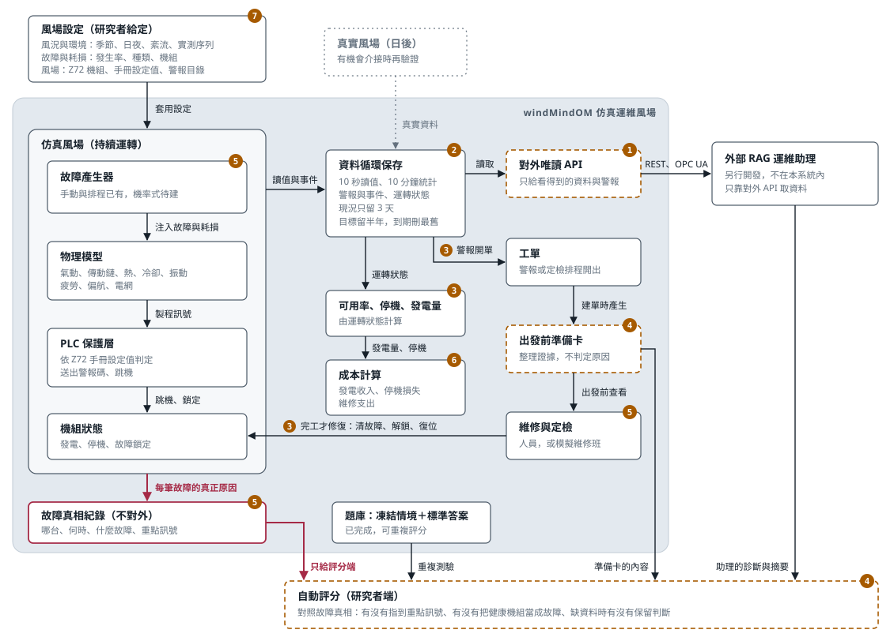

# 仿真運維風場研究架構

> 版本：v1.0（2026-11-26 劉老師定稿）　依 [DEC-20261125-01](../product/decision_log.md)
> 互動版頁面的連結記在 [`work-logs/2026-11/2026-11-25-research-framework-diagram.md`](../../work-logs/2026-11/2026-11-25-research-framework-diagram.md)。
> 系統內部的細節圖（模組分層、工單狀態機、儲存結構等）見 [`windMindOM-architecture.md`](windMindOM-architecture.md)。

windMindOM 是一座持續運轉的仿真風場。它對外只給看得到的資料與警報，每筆故障的真正原因另外存起來。外部的 RAG 運維助理和工單上的出發前準備卡都只看前者，再拿後者來評分。

**圖 1**　仿真風場一次產生兩份東西。看得到的資料往右走，給對外 API、工單與準備卡、可用率與成本。故障的真正原因往下另存，只有評分端拿得到，所以助理與準備卡的對錯可以自動核對。

| 標記 | 意思 |
|---|---|
| 實線框 | 已有 |
| 虛線框 | 整塊待建 |
| 圓圈數字 | 建置順序，標在待建或要改的地方 |
| 紅線 | 不對外的故障真相 |
| 點線 | 日後 |

## 建置順序

| 順序 | 內容 | Issue | 狀態 |
|---|---|---|---|
| 1 | **對外唯讀 API**：外部助理用一把唯讀金鑰連線，只拿到看得到的資料與警報。 | WMOM-20261125-02 | ✅ 2026-11-26 |
| 2 | **長時間運轉**：資料留半年、近期與長期分層保存、重啟後接續運轉。 | WMOM-20261125-03 | ✅ 2026-11-26（72 小時連續運轉測試與歷史回填另開 WMOM-20261126-01 / -02） |
| 3 | **運維閉環**：警報開單、完工才修復、定檢造成計畫停機、可用率由運轉狀態計算。 | WMOM-20261125-04 | 待建 |
| 4 | **出發前準備卡**：工單建立時產生，故障出勤卡先做；同時建立自動評分。 | WMOM-20261125-05 | 待建 |
| 5 | **機率式故障**：風場自己發生故障、另存故障真相；無人處理時由模擬維修班完工。 | WMOM-20261125-06 | 待建 |
| 6 | **成本**：改吃模擬出來的發電量、停機與維修。 | WMOM-20260504-11 | 待建 |
| 7 | **實測風況**：匯入實測風速序列；物理模型持續加深。 | WMOM-20261125-07 | 待建 |

圖上的實線與虛線是 2026-11-26 定稿時的狀態；之後的進度看這張表的「狀態」欄。

## 這個架構能回答的問題

1. **資料像不像真的？** 仿真風場的讀值與警報，夠不夠當 RAG 運維助理的資料來源。
2. **助理判斷得對嗎？** 外部助理只看得到資料，它的診斷和故障真相對不對得上。
3. **準備卡有沒有用？** 出發前準備卡有沒有指到該看的訊號，有沒有誤導。
4. **運維怎麼影響營運？** 故障、停機與維修如何反映到可用率與成本。

## 圖上沒畫的

- 準備卡還會用到手冊檢索、庫存與過往工單；簽核、報表等既有模組照舊。
- 準備時間能省多少，要等真人試用或接上真實風場才量得到。
- 題庫（凍結情境＋標準答案）是 EPIC-DS 的產出，細節見 [`windMindOM-architecture.md`](windMindOM-architecture.md) §2 與 [`../integration/rag_assistant_data_contract_v1.md`](../integration/rag_assistant_data_contract_v1.md)。

## 修改這張圖

`research-framework.svg` 是手寫的 SVG（亮色、樣式內嵌），直接編輯即可。改了圖要同步上面的建置順序表與 `ISSUES.md` 的 EPIC-SF 表。
