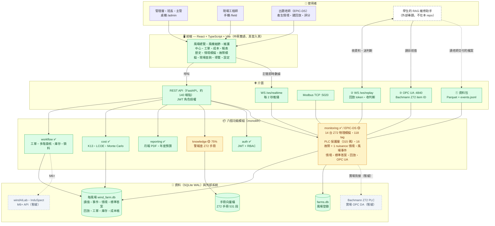
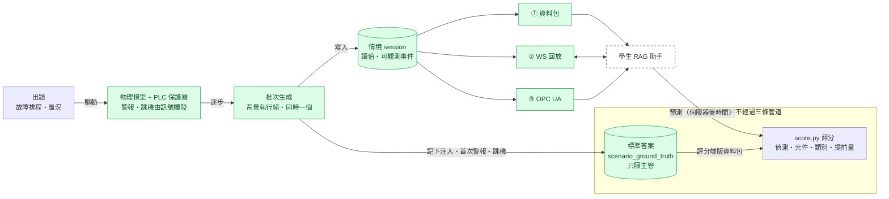
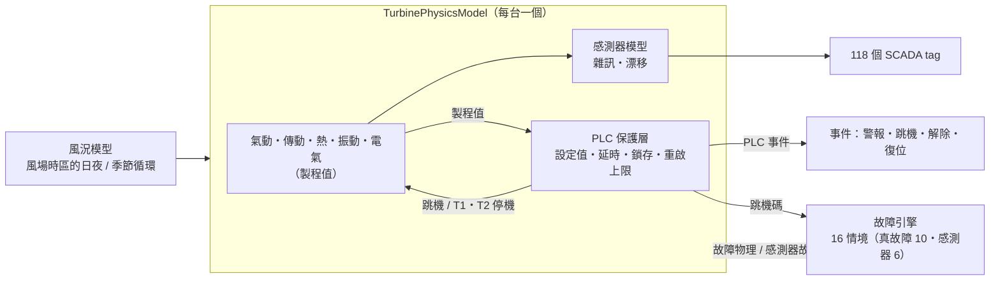
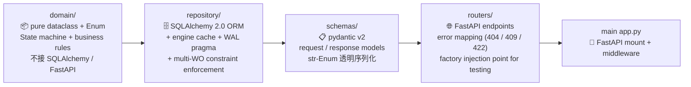
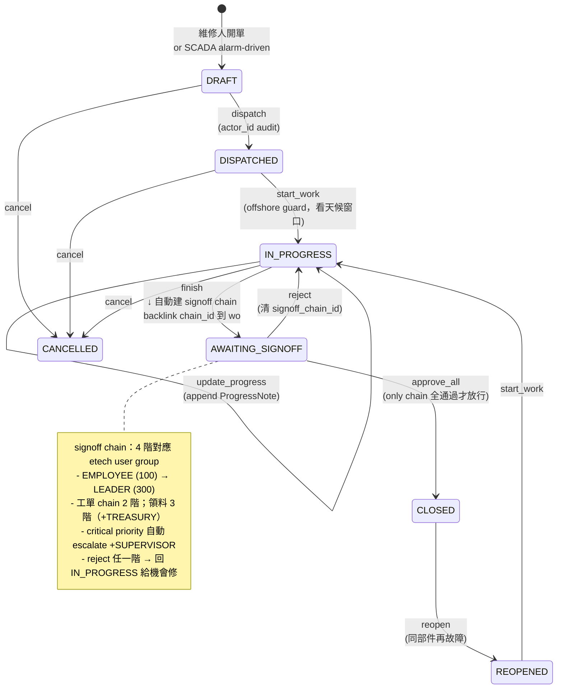
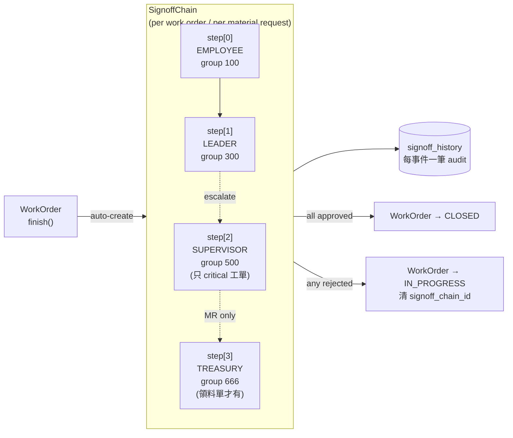
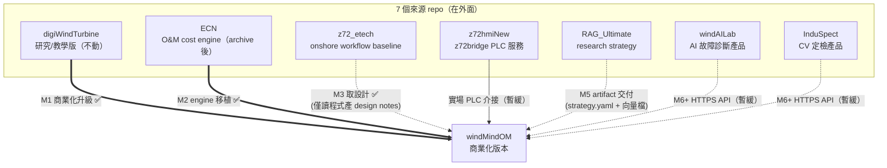
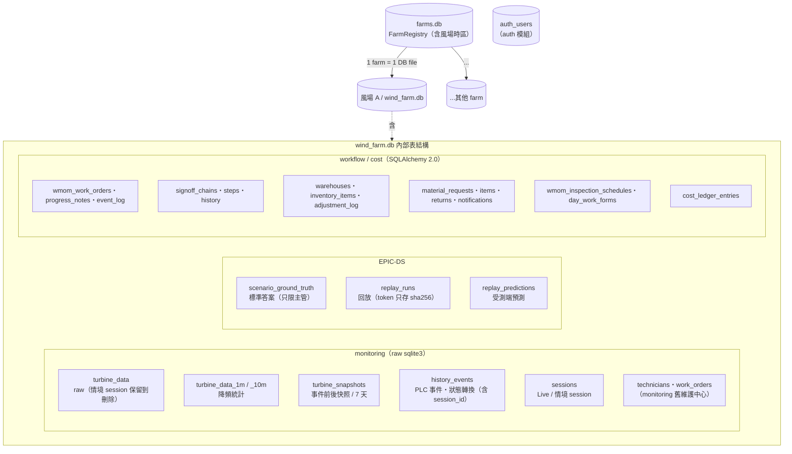
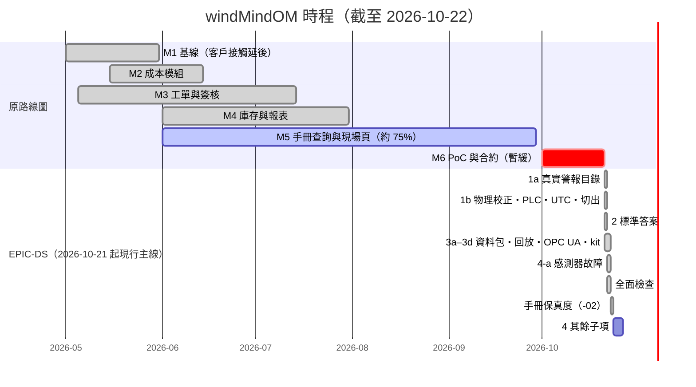

# windMindOM 系統架構全貌

> 版本：v0.8.1 產品基線；狀態截至 **2026-10-23**（EPIC-DS 誤報 / 健康負樣本 WMOM-20261021-08-b 後）
> 受眾：第一次接觸專案的同仁、對外 demo、partner / 學生專題對接
> 先看 §1 一張圖看全貌、§2 現行主線 EPIC-DS 的資料流，再依興趣往下看細節圖。
> 同內容的互動說明頁（含模組卡與進度條）連結記在 [`work-logs/2026-10/2026-10-22-architecture-docs.md`](../../work-logs/2026-10/2026-10-22-architecture-docs.md) §2.1。

---

## 1. 一張圖看全貌

**圖例**：🟢 已完成 / 🟡 進行中 / 灰色虛線 暫緩 / 白色虛線 外部系統

- monitoring 一個模組提供五個介面：WS 即時、Modbus，以及 EPIC-DS 給受測端的三條管道（資料包、WS 回放、OPC UA）。其他模組只經 REST。
- 學生的 RAG 助手不經前端、不開帳號：WS 回放與 OPC UA 用回放 token（OPC UA 匿名唯讀），資料包由老師下載後以檔案交付。

---

## 2. 現行主線：EPIC-DS 擬真資料源

情境一次生成後凍結。讀值與可觀測事件經三條管道給受測端；標準答案另外存放，只在評分時與受測端的預測對照。

| 規則 | 怎麼做到 |
|---|---|
| 受測端看不到答案 | 根因 / 注入資訊只進 `scenario_ground_truth`；給外部的事件一律經 `storage.is_observable_event` 白名單；manifest 不帶情境名稱與故障排程 |
| 三條管道內容一致 | 資料包、WS 回放、OPC UA 讀值逐位元相同（2026-10-22 以真伺服器驗證：12600 筆讀值、43 筆事件、224 窗統計） |
| 時間因果 | 預測的 `ts` 由伺服器在收到時蓋上；判斷得慢，提前量就少 |
| 正式評測的前提 | 伺服器 `WMOM_AUTH_ENFORCE=true`（否則不能建立）；單次直播不能暫停 / 倒帶；整台伺服器正式評測總速率 ≤ 1000 筆讀值 / 秒（DEC-20261022-05） |
| 擬真 | 警報碼、文字、等級以 Z72 真實目錄為準（xlsx 314 碼＋手冊獨有的 A039）；PLC 設定值依手冊 Appendix D；資料包 102 欄 = 47 個真實 Bachmann tag + 55 個合成 tag |

介面合約：[`docs/integration/rag_assistant_data_contract_v1.md`](../integration/rag_assistant_data_contract_v1.md)（v1.5）；設計與各階段紀錄：[`docs/product/EPIC-DS_realistic_data_source.md`](../product/EPIC-DS_realistic_data_source.md)；學生 starter kit：[`examples/rag_starter_kit/`](../../examples/rag_starter_kit/)。

---

## 3. monitoring 內部：一步模擬做了什麼

- **PLC 只看製程值**（感測器模型之前）；唯一例外是注入的感測器故障：那支感測器的故障讀值同時給 PLC 與 SCADA。
- **資料來源**：即時模擬（Live 迴圈）、產生情境（批次，背景執行緒）、調閱過去情境；實場 OPC DA 暫緩。
- **熱模型**以 Z72 額定功率正規化：其他機型（前端可選的 Vestas、SG、Goldwind）共用 Z72 的 PLC 設定值與警報目錄，健康機組不會被誤跳機。

---

## 4. 模組內部分層（典型 pattern — 以 workflow 為例）

每個 module 走相同四層分層，pure Python → 漸增 framework 依賴：

**為什麼分這四層**：
- **domain** 純 Python 可單獨測試，未來換 ORM/框架不影響邏輯
- **repository** 集中 DB 細節 + business rule（如「一台風機 ≤ 3 OPEN 工單」）
- **schemas** 對外 API contract，與 domain 對齊但不共用 class（pydantic vs dataclass）
- **routers** 薄層 — 只做 HTTP / DI / error mapping

monitoring 是 digiWT 搬入的既有結構（`simulator/` + `server/`，raw sqlite3），沒有套這四層。

---

## 5. Work Order 狀態機（M3）

**整合點**：
- 工單 finish → `signoff_repository.create_chain_for_work_order()` 自動建 chain
- 簽核 last step approved → 自動觸發 `work_order.approve_all()` → CLOSED
- 簽核任一階 reject → 自動 `work_order.reject(reason)` → IN_PROGRESS
- 失敗時 API 回 200 + `subject_transition_error` 欄位（不藏 chain 已決定的事實）

---

## 6. Approval 4 階 signoff chain

**設計重點（DN-02 walkthrough confirmed）**：
- 線性簽核（schema 預留 `parallel_group_id` 給未來並行簽，目前 NotImplementedError）
- 完整 `signoff_history` 給 KPI 用（誰退最多 / 哪類常被退）
- POST `/work-orders/{id}/approve` 強制檢查 `chain.overall_status == APPROVED`（防 bypass）

---

## 7. 與 7 個來源 repo 的關係

| Repo | 角色 | windMindOM 對它做什麼 |
|------|------|---------------------|
| **digiWindTurbine** | 物理模擬 + SCADA 平台 | 不動，留作研究 / 教學版本 |
| **ECN** | O&M cost calculation engine | M2 完成移植進 `modules/cost/`；原 repo archive |
| **z72_etech** | 益泰運維廠商 onshore workflow | M3 取設計（design notes 在 `docs/design-notes/m3/`），**不取程式** |
| **z72hmiNew** | z72bridge PLC service | 留外面；實場 OPC DA 介接隨 M6 暫緩（`shared/plc_clients/bachmann/` 有讀取程式） |
| **windAILab** | AI 故障診斷產品 | 留外面（**另一公司業務**）；M6+ HTTP API 介接（暫緩） |
| **RAG_Ultimate** | research RAG strategy | 留外面（research line）；M5 artifact 交付 |
| **InduSpect** | CV 定檢產品 | 留外面（independent product）；M6+ HTTP API 介接（暫緩） |

另有**學生專題的 RAG 即時維修助手**（不在本 repo）：只透過 EPIC-DS 的介面合約與三條管道取資料。

---

## 8. Storage 結構（per-farm）

**設計重點**：
- **per-farm DB** — 每個風場 `wind_farm.db`（在 `modules/monitoring/data/farms/{farm_id}/`），由 `FarmRegistry` 集中管理；回放與 token 也存在目前風場的 DB（正式評測進行中不能切換風場）。
- **monitoring 用 raw sqlite3 + WAL**；**workflow / cost 用 SQLAlchemy 2.0 + 同 WAL**，並存無衝突。
- **時間戳一律 UTC**（`...ffffff+00:00`，SQLite 靠字串字典序比較）；舊 DB 開檔時一次性轉換。
- **Retention**：Live 的 raw 3 天 / 1m 90 天 / 10m 永久；情境 session 的 raw 保留到情境刪除。

---

## 9. 時程（原 6 個月路線圖 + 現行主線）

| 項目 | 狀態 |
|---|---|
| M1 基線建置 | 85%（技術基線完成；客戶接觸隨 M6 延後） |
| M2 成本 / M3 工單 / M4 庫存與報表 | 100% |
| M5 手冊查詢與現場頁 | 75%（剩客戶手冊、一年警報資料，隨 M6 暫緩） |
| M6 PoC 與合約 | 暫緩（DEC-20261021-01）；auth 已完成部分保留 |
| EPIC-DS | 95%：Phase 1a–3d、4-a、4-b（誤報 / 健康負樣本）、全面檢查、手冊保真度完成；下一步 -08 其餘子項（多重故障 + 早期徵兆、故障庫擴充，先請劉老師挑） |

測試：backend 2051 passed / 7 skipped / 1 xfailed；frontend vitest 1513 passed（2026-10-23）。

---

## 10. 一句話總結

> **windMindOM = digiWindTurbine 商業化升級**：物理模擬 + SCADA 平台加上運維模組（monitoring / workflow / cost / reporting / knowledge / auth）與雙 persona UI。2026-10-21 起商業時程暫停，現行主線是 **EPIC-DS**：用 Z72 物理模擬器 + PLC 保護層產生附標準答案的擬真資料，經資料包、WebSocket 回放、OPC UA 三條管道給外部 RAG 維修助手做盲測。

---

## 11. 進一步閱讀

| 想知道 | 看哪 |
|---|---|
| 產品定位 / ICP / 功能模組 | [`docs/product/PRODUCT_VISION.md`](../product/PRODUCT_VISION.md) |
| 模組詳細設計 + 整合 | [`docs/product/MVP_ARCHITECTURE.md`](../product/MVP_ARCHITECTURE.md) |
| 路線圖與現行主線 | [`docs/product/ROADMAP.md`](../product/ROADMAP.md) |
| EPIC-DS 設計與各階段紀錄 | [`docs/product/EPIC-DS_realistic_data_source.md`](../product/EPIC-DS_realistic_data_source.md) |
| 給受測端的介面合約（v1.5） | [`docs/integration/rag_assistant_data_contract_v1.md`](../integration/rag_assistant_data_contract_v1.md) |
| 學生 starter kit | [`examples/rag_starter_kit/`](../../examples/rag_starter_kit/) |
| 重大決策（最新 DEC-20261022-05） | [`docs/product/decision_log.md`](../product/decision_log.md) |
| M3 工單 / 簽核 / 庫存設計 | [`docs/design-notes/m3/`](../design-notes/m3/) |
| 既有 digiWT 物理模型細節 | [`docs/legacy/digiwt_project_notes.md`](../legacy/digiwt_project_notes.md) |
| API endpoint 規格 | [`docs/API_GUIDE.md`](../API_GUIDE.md) |
| 任務追蹤 | [`ISSUES.md`](../../ISSUES.md) + [`STATUS.yaml`](../../STATUS.yaml) |
